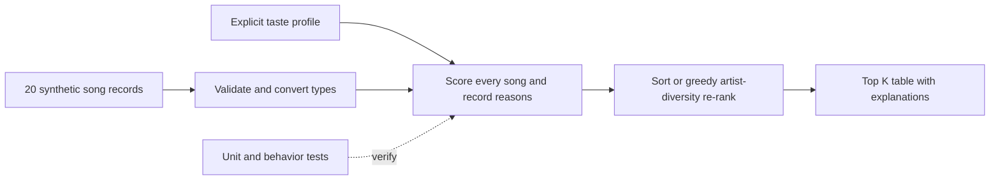

# VibeFinder: Music Recommender Simulation

A CLI-first, content-based recommendation simulator for AI110 Project 3. It loads 20 synthetic songs, compares explicit taste profiles with song features, and explains each score. It is a transparent rule-based simulation, not a trained model or a connection to Spotify.

## How The System Works

Real recommendation systems combine item information with user feedback. Content-based filtering compares item attributes with a user's preferences. Collaborative filtering uses patterns across users and items; it can surface something a similar listener enjoyed. Inputs can include likes, skips, listening history, playlists, and song properties. Preferences describe what a listener wants; the scoring rule evaluates one song; ranking orders the whole candidate list. This simulator uses explicit preferences and hand-assigned attributes, not other users' behavior.

Sources: [Google: content-based filtering](https://developers.google.com/machine-learning/recommendation/content-based/basics), [Google: collaborative filtering](https://developers.google.com/machine-learning/recommendation/collaborative/basics).

`Song` stores ID, title, artist, genre, mood, energy, tempo, valence, danceability, and acousticness. The CSV loader returns dictionaries with numeric fields converted. The starter `Song`, `UserProfile`, and `Recommender` interfaces also work; both interfaces share the same scorer. `UserProfile` records favorite genre, favorite mood, target energy, and an acoustic preference. The CLI uses genre, mood, and energy dictionaries.

### Algorithm Recipe

- Genre-first: genre match +2, mood match +1, energy similarity +1 x (1 - absolute energy gap).
- Mood-first: genre +1, mood +2, energy similarity +1.
- Energy-first: genre +1, mood +1, energy similarity +2. This halves genre and doubles energy relative to the baseline.
- If an acoustic preference is supplied through the OOP interface, add up to 0.25 for acousticness (or its complement).
- Rank scores highest first; break ties by song ID. Every contribution is included in the explanation. The input catalog is not changed.
- Optional greedy diversity re-ranking subtracts a configurable penalty for each previously selected song by that artist. Adjusted scores can be negative and selection follows the current penalty, rather than a single global sort.

Tempo, valence, and danceability are loaded and documented, but do not contribute to this baseline scorer. Numeric inputs must be finite; unit-scale features must be in [0, 1].



## Setup and Run

Python 3.9+ is sufficient. The application uses the standard library; pytest is only needed for tests.

```bash
python3 -m venv .venv
source .venv/bin/activate
python -m pip install -r requirements.txt
python -m src.main --profile all
python -m src.main --profile pop --mode mood-first --diversity 2
python -m pytest -q
```

On Windows activate with `.venv\Scripts\activate`. Run commands from the repository root. No API key, account, network request, or paid service is required.

## Sample Recommendation Output

Actual command output for three distinct profiles (also committed in `evidence/run-1.txt`):

```text
$ python3 -m src.main --profile all
Loaded songs: 20 | mode: genre-first

Profile: pop {'genre': 'pop', 'mood': 'happy', 'energy': 0.8}
#   Title                     Artist              Score
----------------------------------------------------------
1   Weekend Skyline           Neon Echo           3.99
    Because: genre match (+2.00); mood match (+1.00); energy gap 0.01 (+0.99)
2   Sunrise City              Neon Echo           3.98
    Because: genre match (+2.00); mood match (+1.00); energy gap 0.02 (+0.98)
3   Gym Hero                  Max Pulse           2.87
    Because: genre match (+2.00); energy gap 0.13 (+0.87)
4   Rooftop Lights            Indigo Parade       1.96
    Because: mood match (+1.00); energy gap 0.04 (+0.96)
5   Desert Festival           Sol Dorado          1.94
    Because: mood match (+1.00); energy gap 0.06 (+0.94)

Profile: lofi {'genre': 'lofi', 'mood': 'chill', 'energy': 0.35}
#   Title                     Artist              Score
----------------------------------------------------------
1   Library Rain              Paper Lanterns      4.00
    Because: genre match (+2.00); mood match (+1.00); energy gap 0.00 (+1.00)
2   Soft Desk Lamp            LoRoom              3.98
    Because: genre match (+2.00); mood match (+1.00); energy gap 0.02 (+0.98)
3   Midnight Coding           LoRoom              3.93
    Because: genre match (+2.00); mood match (+1.00); energy gap 0.07 (+0.93)
4   Focus Flow                LoRoom              2.95
    Because: genre match (+2.00); energy gap 0.05 (+0.95)
5   Spacewalk Thoughts        Orbit Bloom         1.93
    Because: mood match (+1.00); energy gap 0.07 (+0.93)

Profile: rock {'genre': 'rock', 'mood': 'intense', 'energy': 0.9}
#   Title                     Artist              Score
----------------------------------------------------------
1   Storm Runner              Voltline            3.99
    Because: genre match (+2.00); mood match (+1.00); energy gap 0.01 (+0.99)
2   After the Storm           Voltline            3.98
    Because: genre match (+2.00); mood match (+1.00); energy gap 0.02 (+0.98)
3   Gym Hero                  Max Pulse           1.97
    Because: mood match (+1.00); energy gap 0.03 (+0.97)
4   Electric Horizon          Pulse Atlas         1.94
    Because: mood match (+1.00); energy gap 0.06 (+0.94)
5   Desert Festival           Sol Dorado          0.96
    Because: energy gap 0.04 (+0.96)
```

The pop and rock profiles favor higher-energy tracks, but their matching genres put different songs first. Lofi versus pop shifts the top result to lower-energy chill music. Lofi versus rock changes both genre and target energy, producing different first choices. These are checks against the chosen rules, not measured listener satisfaction.

## Experiments You Tried

The conflicting profile requests ambient, sad, high-energy music. With genre-first, the first result is Spacewalk Thoughts (2.33). After halving genre weight and doubling energy weight, it becomes Electric Horizon (1.98). The altered result is different, not evidence of being more accurate for a real person.

```text
$ python3 -m src.main --profile conflicting --mode genre-first
Loaded songs: 20 | mode: genre-first

Profile: conflicting {'genre': 'ambient', 'mood': 'sad', 'energy': 0.95}
#   Title                     Artist              Score
----------------------------------------------------------
1   Spacewalk Thoughts        Orbit Bloom         2.33
    Because: genre match (+2.00); energy gap 0.67 (+0.33)
2   Blue Window               Velvet Current      1.43
    Because: mood match (+1.00); energy gap 0.57 (+0.43)
3   Electric Horizon          Pulse Atlas         0.99
    Because: energy gap 0.01 (+0.99)
4   Gym Hero                  Max Pulse           0.98
    Because: energy gap 0.02 (+0.98)
5   Storm Runner              Voltline            0.96
    Because: energy gap 0.04 (+0.96)
$ python3 -m src.main --profile conflicting --mode energy-first
Loaded songs: 20 | mode: energy-first

Profile: conflicting {'genre': 'ambient', 'mood': 'sad', 'energy': 0.95}
#   Title                     Artist              Score
----------------------------------------------------------
1   Electric Horizon          Pulse Atlas         1.98
    Because: energy gap 0.01 (+1.98)
2   Gym Hero                  Max Pulse           1.96
    Because: energy gap 0.02 (+1.96)
3   Storm Runner              Voltline            1.92
    Because: energy gap 0.04 (+1.92)
4   Blue Window               Velvet Current      1.86
    Because: mood match (+1.00); energy gap 0.57 (+0.86)
5   After the Storm           Voltline            1.86
    Because: energy gap 0.07 (+1.86)
```

Without a diversity penalty, Neon Echo occupies the first two pop results. With penalty 2, a different artist moves into the second position. This improves artist variety at a relevance trade-off; it does not establish demographic fairness.

```text
$ python3 -m src.main --profile pop --diversity 2
Loaded songs: 20 | mode: genre-first

Profile: pop {'genre': 'pop', 'mood': 'happy', 'energy': 0.8}
#   Title                     Artist              Score
----------------------------------------------------------
1   Weekend Skyline           Neon Echo           3.99
    Because: genre match (+2.00); mood match (+1.00); energy gap 0.01 (+0.99)
2   Gym Hero                  Max Pulse           2.87
    Because: genre match (+2.00); energy gap 0.13 (+0.87)
3   Sunrise City              Neon Echo           1.98
    Because: genre match (+2.00); mood match (+1.00); energy gap 0.02 (+0.98); repeated artist (-2.00)
4   Rooftop Lights            Indigo Parade       1.96
    Because: mood match (+1.00); energy gap 0.04 (+0.96)
5   Desert Festival           Sol Dorado          1.94
    Because: mood match (+1.00); energy gap 0.06 (+0.94)
```

## Tests and Validation

The two starter tests are retained. Added tests check exact scoring, energy proximity, three profiles, non-mutation, mode differences, diversity, case normalization, empty catalogs, invalid numeric inputs, invalid K, and missing CSV columns.

```text
$ .venv/bin/python -m pytest -q
........................                                                 [100%]
24 passed in 0.03s
```

## Limitations and Risks

The catalog is small and synthetic. Song attributes are invented examples, not measurements of actual recordings. A strong genre weight can create a filter bubble; exact labels miss related genres such as pop and indie pop. There are no lyrics, listening-history signals, language preferences, or popularity estimates. Scores are relevance points, not probabilities or confidence in musical enjoyment.

## AI-Assisted Engineering Reflection

Codex implemented the code and ran the saved commands in this repository in response to the coursework request. The important lesson illustrated here is that understandable weights can already produce personalized-looking rankings, but that does not prove taste prediction. The implementation uses energy proximity instead of simply rewarding high energy, and keeps the CSV order unchanged by sorting a separate list. Suggested complexity such as a web UI and extra dependencies was omitted to keep the CLI easy to explain and reproduce. No human listening study or independent manual code review is claimed. See [model_card.md](model_card.md) and [ai_interactions.md](ai_interactions.md).
